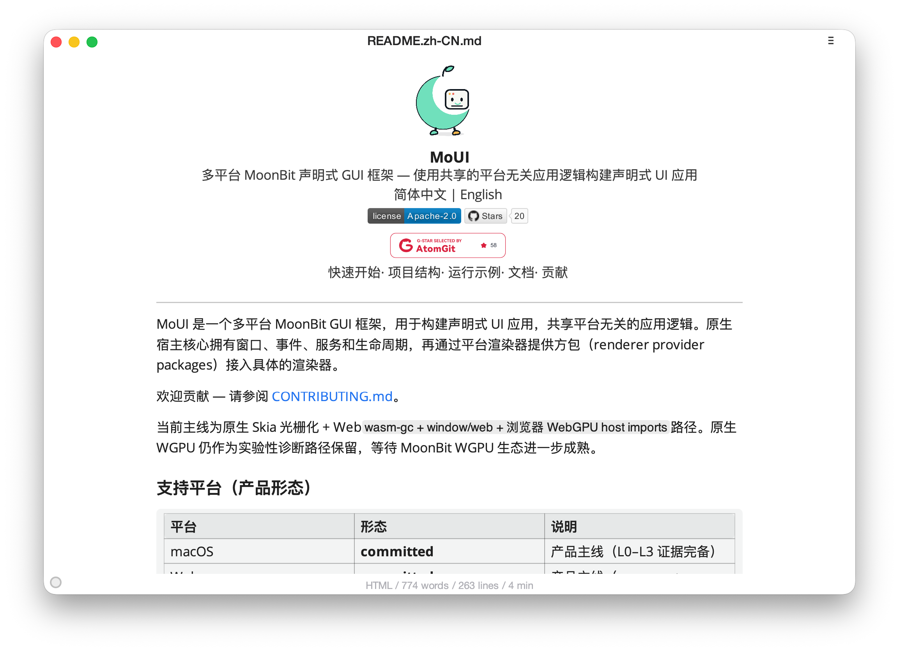

# MoMark (Markdown Editor)

<div align="center">
  
</div>

MoMark is a Typora-style WYSIWYG Markdown editing prototype. A single typed
Markdown application model is shared between source and visual editing modes,
plus a toolbar, format palette, find/replace, outline, file sidebar, toasts,
and HTML export. It is the standalone continuation of MoUI's
former `examples/markdown_editor` app and the primary proof of the `@moui_richtext` markdown editing surface.

## Package Shape

- `app/` — shared app logic. `MarkdownEditorApp` owns the document session
  (`@moui_richtext.MarkdownDocumentSession`), selection, link/image/
  footnote/html targets, outline visibility, focus/typewriter/zen modes,
  toasts, and the action command catalog. The bulk of the code is split across
  `editor_*.mbt` (commands, navigation, settings, snapshot, target-sync),
  `view_*.mbt` (chrome, editor surface, folding, format bubble, inspectors,
  toolbar, toasts), and a large `*_wbtest.mbt` runtime suite.
- `macos_skia/`, `macos_wgpu/`, `windows_skia/`, `windows_wgpu/`,
  `linux_skia/`, `linux_wgpu/` — thin platform entrypoints that run the same
  app. Each native entrypoint takes an optional `<document.md>` argument and
  opens it through the same recent-file open path as the menu.
- `docs/` — long-form editor walkthrough.

## Dependencies

The published versions are declared in `moon.mod`:

```toml
import {
  "wzzc-dev/moui@0.6.1",
  "wzzc-dev/moui_richtext@0.6.1",
  "wzzc-dev/window@0.5.4-0.2.9",
  "wzzc-dev/moui_skia_renderer@0.6.1",
  "wzzc-dev/moui_wgpu_renderer@0.6.1",
  "wzzc-dev/moui_text_providers@0.6.1",
}
```

For development the repository vendors the current MoUI sources instead:

- `vendor/MoUI` is a git submodule pointing at
  [wzzc-dev/MoUI](https://github.com/wzzc-dev/MoUI) (`main`), including its
  `window` submodule.
- The root `moon.work` lists `vendor/MoUI`'s packages as workspace members.
  Members override the registry versions, so `moon build` / `moon test` run
  against the vendored source.
- Workspace commands (including `moon test` and `moon run`) must be executed
  from this repository root.

Initialize or refresh the vendored source:

```sh
git submodule update --init --recursive
# after upstream changes:
git -C vendor/MoUI fetch origin
git -C vendor/MoUI checkout <commit>
git -C vendor/MoUI submodule update --init --recursive
```

## Running

### Commands

```sh
# macOS Skia
moon run macos_skia --target native

# macOS WGPU
moon run macos_wgpu --target native

# Windows Skia (MSVC toolchain; MOUI_FIRST_FRAME_EXIT=1 smoke-runs the first frame)
moon run windows_skia --target native

# Windows WGPU
moon run windows_wgpu --target native

# Linux Skia (MOUI_FIRST_FRAME_EXIT=1 smoke-runs the first frame)
moon run linux_skia --target native

# Linux WGPU
moon run linux_wgpu --target native

```

## Tests

```sh
moon test app --target native
```

The vendored framework packages have their own suites:

```sh
moon test vendor/MoUI/moui/core --target native
moon test vendor/MoUI/moui/runtime --target native
moon test vendor/MoUI/moui/views --target native
moon test vendor/MoUI/moui_richtext --target native
(cd vendor/MoUI/window && moon test --release)
```

The app package ships an extensive runtime whitebox suite covering keyboard
input, block/inline targets, table paste, folding, find/replace, clipboard,
file sidebar, contextual bubbles, command-click, and snapshot formatting.

## Platform Coverage

| Target               | Entrypoint            | Status |
| -------------------- | --------------------- | ------ |
| macOS Skia           | `macos_skia`          | Wired  |
| macOS WGPU           | `macos_wgpu`          | Wired  |
| Windows Skia         | `windows_skia`        | Wired  |
| Windows WGPU         | `windows_wgpu`        | Wired  |
| Linux Skia           | `linux_skia`          | Wired  |
| Linux WGPU           | `linux_wgpu`          | Wired  |

See [docs/markdown-editor.md](docs/markdown-editor.md) for the editing
model narrative.
